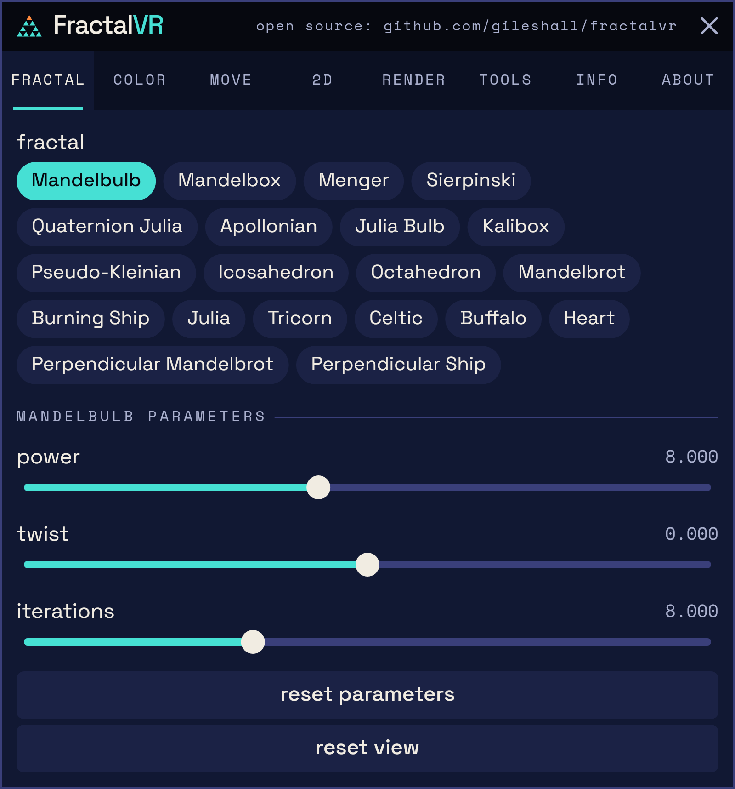
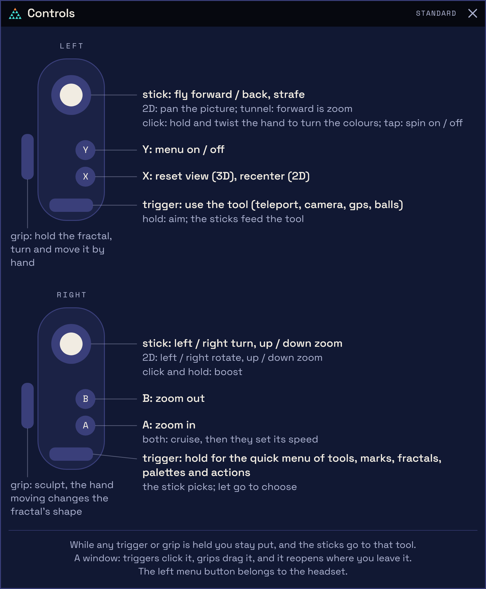

# FractalVR

Fly through fractals in your browser or in a VR headset.

Try it at **[fractalvr.org](https://fractalvr.org)**.

FractalVR ray marches 3D fractals (Mandelbulb, Mandelbox, Menger, Kalibox, Pseudo-Kleinian, Apollonian and more) and draws 2D ones (Burning Ship, Julia, Tricorn and others) in real time with WebGL2. On a WebXR headset such as Meta Quest you stand inside them; on a desktop you fly with mouse and keyboard.

This is an alpha release.

## Running it yourself

You need Node.js 20.19 or newer.

```bash
npm ci
npm run dev
```

The dev server uses https with a self-signed certificate, because WebXR needs a secure context, and listens on your local network so a headset can reach it. Accept the certificate warning, then open the address it prints. For plain http on localhost only, use `npm run dev:http`.

```bash
npm test
npm run build
```

`npm run build` writes a static site to `dist/` that any web server can host.

## Controls

On a desktop: Tab opens the menu, click to look around (Esc lets go), WASD flies, Q/E go down and up, Shift goes faster, the scroll wheel or Z/X zooms, N/P changes fractal, C changes palette. The menu's Info tab lists the rest.

In VR: the left stick flies and the right one turns and zooms. Hold the right trigger for the quick menu of tools, fractals and palettes; Y opens the full menu, with a map of every control beside it.

<p>
  
  
</p>

## Requirements

A browser with WebGL2 and `EXT_color_buffer_float`. VR needs a WebXR headset and browser.

## License

Copyright (C) 2026 Giles Hall.

FractalVR is free software under the GNU Affero General Public License, version 3 only. See [LICENSE](LICENSE). It bundles [three.js](https://threejs.org), under the MIT license, and the Space Grotesk and Space Mono typefaces, under the SIL Open Font License 1.1 (see `public/fonts`).
